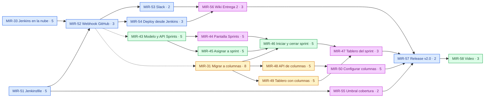

# Plan de trabajo — Entrega 2

Reparto de los 18 items de la Entrega 2 entre los cuatro integrantes, y el
orden en que conviene abordarlos según sus dependencias reales. El detalle de
cada item (historia y criterios de aceptación) está en
[`backlog.md`](./backlog.md#entrega-2).

**Alcance:** **18 items · 74 story points**, en tres frentes:

- **Sprints** (épica 7, 23 pts): requerimiento funcional nuevo.
- **Columnas configurables** (épica 8, 23 pts): requerimiento funcional nuevo.
- **CI/CD con Jenkins** (épica 9, 20 pts) más el cierre de la entrega (8 pts).

---

## 1. Reparto por integrante

Mismo criterio que en la Entrega 1: cada persona es dueña de un **módulo
completo**, para que trabaje casi siempre en sus propios archivos.

### Benjamín — CI/CD y release · 20 pts

| Item | Pts | Prioridad | Descripción |
| --- | --- | --- | --- |
| `MIR-33` | 5 | Highest | Jenkins en la nube |
| `MIR-51` | 5 | Highest | Pipeline en `Jenkinsfile` |
| `MIR-52` | 3 | Highest | Webhook de GitHub y estado en el commit |
| `MIR-53` | 2 | High | Notificaciones a Slack |
| `MIR-54` | 3 | Medium | Despliegue desde Jenkins |
| `MIR-57` | 2 | Highest | Release `v2.0-entrega2` |

Sigue con la infraestructura, que ya conoce por el despliegue de la Entrega 1
(MIR-27). **`MIR-52` tiene que estar listo antes de que se fusione el primer PR
de los requerimientos nuevos**: el enunciado pide que Jenkins se ejecute con
los cambios asociados a ellos.

### Isaías — Sprints (dominio y API) · 18 pts

| Item | Pts | Prioridad | Descripción |
| --- | --- | --- | --- |
| `MIR-43` | 5 | Highest | Modelo y API de Sprints |
| `MIR-45` | 5 | High | Asignar elementos a un sprint |
| `MIR-46` | 5 | High | Iniciar y cerrar un sprint |
| `MIR-58` | 3 | High | Cápsula de video de la Entrega 2 |

Los sprints cuelgan de los elementos de trabajo, que son su módulo. `MIR-43`
desbloquea a Diego, así que va primero.

### Mauro — Columnas configurables · 18 pts

| Item | Pts | Prioridad | Descripción |
| --- | --- | --- | --- |
| `MIR-31` | 8 | Highest | Migrar los estados a columnas por proyecto |
| `MIR-48` | 5 | Highest | API de columnas |
| `MIR-49` | 5 | High | Tablero y backlog con las columnas del proyecto |

Es dueño del tablero desde la Entrega 1. `MIR-31` es el item más grande y el
más riesgoso (migra datos reales): conviene revisarlo en pareja.

### Diego — Pantallas, calidad y Wiki · 18 pts

| Item | Pts | Prioridad | Descripción |
| --- | --- | --- | --- |
| `MIR-44` | 5 | Highest | Pantalla de Sprints |
| `MIR-47` | 3 | Medium | Tablero del sprint activo |
| `MIR-50` | 5 | High | Pantalla de configuración de columnas |
| `MIR-55` | 2 | High | Umbral de cobertura que rompe el build |
| `MIR-56` | 3 | High | Wiki de la Entrega 2 |

Los permisos de las pantallas nuevas (VIEWER no edita, solo OWNER configura
columnas) pasan por `can()` de `packages/shared`, que ya conoce de la Entrega 1.

---

## 2. DAG de dependencias

Cada flecha significa *"esto tiene que existir antes"*. La flecha punteada
significa *"tiene que estar listo antes de fusionar"*, no antes de empezar. El
color indica quién es el responsable.



| Color | Responsable |
| --- | --- |
| Azul | Benjamín |
| Verde | Isaías |
| Amarillo | Mauro |
| Morado | Diego |

`MIR-43`, `MIR-31`, `MIR-33` y `MIR-51` no tienen predecesores: **se pueden
empezar hoy**, los cuatro en paralelo.

---

## 3. La ruta crítica

Hay dos cadenas empatadas en 23 puntos, una por cada requerimiento nuevo:

```
MIR-43 → MIR-45 → MIR-46 → MIR-47 → MIR-57 → MIR-58
  5       5       5       3       2       3      = 23 pts

MIR-31 → MIR-48 → MIR-50 → MIR-57 → MIR-58
  8       5       5       2       3              = 23 pts
```

La de Jenkins (`MIR-33 → MIR-52 → MIR-54 → MIR-56 → MIR-57 → MIR-58`) suma 19 y
tiene holgura, pero `MIR-52` igual tiene que llegar temprano por la flecha
punteada.

1. **Los dos requerimientos se cruzan en `MIR-46`.** El cierre de sprint espera tanto a
   Isaías (`MIR-45`) como a Mauro (`MIR-31`), porque el cierre usa la categoría
   `DONE` de las columnas para saber qué está terminado. Si `MIR-31` se atrasa,
   se atrasa el cierre de sprint.

2. **`MIR-31` y `MIR-43` migran el esquema al mismo tiempo.** Las dos tocan
   `schema.prisma`. Una migración por PR, y quien fusione segundo regenera la
   suya sobre `develop` antes de pedir revisión.

3. **`MIR-47` (tablero del sprint, 3 pts) es el primer candidato a recortar.**
   El requerimiento de Sprints ya se cumple con crear, asignar, iniciar y
   cerrar; filtrar el tablero es comodidad.

---

## 4. Orden sugerido por olas

### Ola 0 — se puede empezar ya

| Quién | Item |
| --- | --- |
| Benjamín | `MIR-33` Jenkins y `MIR-51` Jenkinsfile, en paralelo |
| Isaías | `MIR-43` modelo y API de Sprints ← **desbloquea a Diego** |
| Mauro | `MIR-31` migración a columnas ← **el item más grande** |
| Diego | Medir la línea base de cobertura (`MIR-55`) y maquetar la pantalla de Sprints con MSW |

### Ola 1 — apenas existan `MIR-43`, `MIR-31` y `MIR-33`

`MIR-52` webhook (Benjamín) · `MIR-45` (Isaías) · `MIR-48` y `MIR-49` (Mauro) ·
`MIR-44` y `MIR-55` (Diego)

### Ola 2

`MIR-53` Slack y `MIR-54` deploy (Benjamín) · `MIR-46` (Isaías) · `MIR-50` (Diego)

### Ola 3 — cierre de funcionalidad

`MIR-47` tablero del sprint (Diego) · `MIR-56` Wiki (Diego, pero se alimenta
desde la Ola 0 con capturas y problemas encontrados)

### Ola 4 — entrega

`MIR-57` release (Benjamín) · `MIR-58` video (Isaías)

---

## 5. Reglas de trabajo

Siguen las de la Entrega 1 ([`plan-trabajo.md` §5](./plan-trabajo.md#5-reglas-de-trabajo)):
GitFlow con una rama por item desde `develop`, revisión cruzada en rueda y la
misma Definición de Hecho. Cambios para esta entrega:

- **Definición de Hecho:** además de lo anterior, el build de Jenkins del PR
  está en verde y la notificación llegó a Slack.
- **Zonas compartidas nuevas:** `Jenkinsfile` (solo Benjamín; los demás
  proponen cambios en el PR) y `vitest.config.ts` (el umbral de cobertura no se
  baja para que pase un PR).
- **Evidencia desde el primer día:** cada problema con Jenkins se anota con su
  solución mientras ocurre; el Anexo A pide la sección "problemas encontrados y
  soluciones" y el video también.
