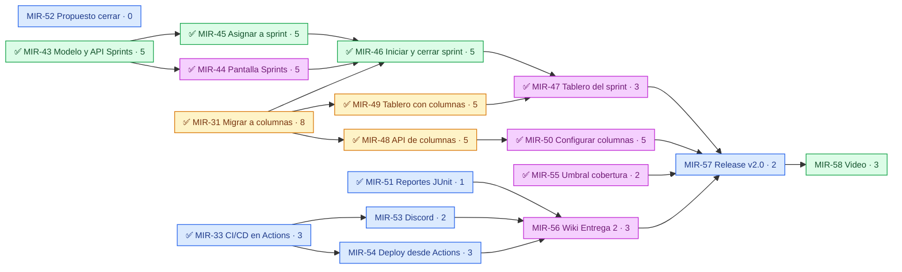

# Plan de trabajo — Entrega 2

Reparto de los 18 items de la Entrega 2 entre los cuatro integrantes, y el
orden en que conviene abordarlos según sus dependencias reales. El detalle de
cada item (historia y criterios de aceptación) está en
[`backlog.md`](./backlog.md#entrega-2).

**Alcance:** **18 items · 65 story points**, en tres frentes:

- **Sprints** (épica 7, 23 pts): requerimiento funcional nuevo.
- **Columnas configurables** (épica 8, 23 pts): requerimiento funcional nuevo.
- **CI/CD con GitHub Actions** (épica 9, 11 pts) más el cierre de la entrega (8 pts).

**Estado:** 12 items fusionados en `develop` (52 pts), marcados con ✅ en este
documento. Quedan **5 items · 13 pts** pendientes, más `MIR-52`, que se propone
cerrar sin trabajo. `MIR-54` cuenta como pendiente mientras su PR (#52) siga
abierto.

---

## 1. Reparto por integrante

Mismo criterio que en la Entrega 1: cada persona es dueña de un **módulo
completo**, para que trabaje casi siempre en sus propios archivos.

### Benjamín — CI/CD y release · 11 pts

| Item | Pts | Prioridad | Descripción |
| --- | --- | --- | --- |
| `MIR-33` | 3 | Highest | CI/CD oficial en GitHub Actions ✅ |
| `MIR-51` | 1 | Highest | Reportes JUnit del pipeline como artefacto ✅ |
| `MIR-52` | 0 | Highest | Webhook de GitHub y estado en el commit (propuesto cerrar) |
| `MIR-53` | 2 | High | Notificaciones a Discord |
| `MIR-54` | 3 | Medium | Despliegue desde GitHub Actions |
| `MIR-57` | 2 | Highest | Release `v2.0-entrega2` |

Sigue con la infraestructura, que ya conoce por el despliegue de la Entrega 1
(MIR-27). Con [D14](./decisiones-tecnicas.md#d14--github-actions-como-cicd-oficial)
el pipeline ya existía: corre en cada push y PR, incluidos los de los
requerimientos nuevos, así que lo que el enunciado pide ya se cumple desde
`MIR-43` y `MIR-31`. Por eso este módulo quedó en 11 puntos frente a los 18 del
resto; un reparto más parejo queda por decidir en equipo.

### Isaías — Sprints (dominio y API) · 18 pts

| Item | Pts | Prioridad | Descripción |
| --- | --- | --- | --- |
| `MIR-43` | 5 | Highest | Modelo y API de Sprints ✅ |
| `MIR-45` | 5 | High | Asignar elementos a un sprint ✅ |
| `MIR-46` | 5 | High | Iniciar y cerrar un sprint ✅ |
| `MIR-58` | 3 | High | Cápsula de video de la Entrega 2 |

Los sprints cuelgan de los elementos de trabajo, que son su módulo.

### Mauro — Columnas configurables · 18 pts

| Item | Pts | Prioridad | Descripción |
| --- | --- | --- | --- |
| `MIR-31` | 8 | Highest | Migrar los estados a columnas por proyecto ✅ |
| `MIR-48` | 5 | Highest | API de columnas ✅ |
| `MIR-49` | 5 | High | Tablero y backlog con las columnas del proyecto ✅ |

Es dueño del tablero desde la Entrega 1. Su módulo está completo.

### Diego — Pantallas, calidad y Wiki · 18 pts

| Item | Pts | Prioridad | Descripción |
| --- | --- | --- | --- |
| `MIR-44` | 5 | Highest | Pantalla de Sprints ✅ |
| `MIR-47` | 3 | Medium | Tablero del sprint activo ✅ |
| `MIR-50` | 5 | High | Pantalla de configuración de columnas ✅ |
| `MIR-55` | 2 | High | Umbral de cobertura que rompe el build ✅ |
| `MIR-56` | 3 | High | Wiki de la Entrega 2 |

Los permisos de las pantallas nuevas (VIEWER no edita, solo OWNER configura
columnas) pasan por `can()` de `packages/shared`, que ya conoce de la Entrega 1.

---

## 2. DAG de dependencias

Cada flecha significa *"esto tiene que existir antes"*. El color indica quién es
el responsable y ✅ marca lo que ya está fusionado en `develop`. `MIR-52` queda
suelto porque nada depende de él.



| Color | Responsable |
| --- | --- |
| Azul | Benjamín |
| Verde | Isaías |
| Amarillo | Mauro |
| Morado | Diego |

`MIR-53` y `MIR-54` no tienen predecesores pendientes: **se pueden trabajar
hoy**, en paralelo.

---

## 3. La ruta crítica

Contando solo los items pendientes, la ruta crítica es la del despliegue, con 11
puntos. Le sigue por uno la de las notificaciones:

```
MIR-54 → MIR-56 → MIR-57 → MIR-58
  3       3       2       3                      = 11 pts

MIR-53 → MIR-56 → MIR-57 → MIR-58
  2       3       2       3                      = 10 pts
```

Sprints y Columnas ya no tienen trabajo por delante del release.

1. **`MIR-54` es la cabeza de la ruta crítica.** Su PR (#52) sigue abierto y es
   lo único que falta para que `MIR-57` quede "desplegado por el pipeline".

2. **`MIR-53` y `MIR-54` se tocan en el aviso de despliegue.** El que se fusione
   segundo lo deja funcionando.

3. **`MIR-56` espera a los dos.** Sus secciones de pipeline, integraciones y
   evidencias dependen de `MIR-53` y `MIR-54`, y quedan marcadas con ⏳ mientras
   tanto.

---

## 4. Orden sugerido por olas

### Ola 0 — fusionada

`MIR-33` · `MIR-51` (Benjamín) · `MIR-43` · `MIR-45` · `MIR-46` (Isaías) ·
`MIR-31` · `MIR-48` · `MIR-49` (Mauro) · `MIR-44` · `MIR-47` · `MIR-50` ·
`MIR-55` (Diego)

### Ola 1 — se puede trabajar ya

`MIR-54` deploy, con su PR abierto, y `MIR-53` Discord (Benjamín)

### Ola 2 — cierre de la documentación

`MIR-56` Wiki (Diego, pero se alimenta con capturas y problemas encontrados
durante toda la entrega)

### Ola 3 — entrega

`MIR-57` release (Benjamín) · `MIR-58` video (Isaías)

---

## 5. Reglas de trabajo

Siguen las de la Entrega 1 ([`plan-trabajo.md` §5](./plan-trabajo.md#5-reglas-de-trabajo)):
GitFlow con una rama por item desde `develop`, revisión cruzada en rueda y la
misma Definición de Hecho. Cambios para esta entrega:

- **Definición de Hecho:** además de lo anterior, los checks `Lint, tipos y
  pruebas` y `Build` del PR están en verde. Desde `MIR-53`, un fallo del pipeline
  avisa en `#mira-ci`.
- **Zonas compartidas nuevas:** `.github/workflows/ci.yml` (solo Benjamín; los
  demás proponen cambios en el PR, y sus jobs no se renombran porque son checks
  obligatorios de `main`) y `vitest.config.ts` (el umbral de cobertura no se
  baja para que pase un PR).
- **Evidencia desde el primer día:** cada problema con el pipeline se anota con
  su solución mientras ocurre; el Anexo A pide la sección "problemas encontrados
  y soluciones" y el video también.
