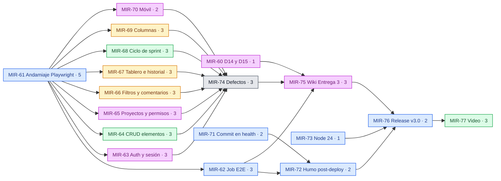

# Plan de trabajo — Entrega 3

Así se reparten los 18 items de la Entrega 3 entre los cuatro integrantes, y
en qué orden conviene abordarlos según sus dependencias reales. El detalle de
cada item y las decisiones de diseño están en
[`backlog.md`](./backlog.md#entrega-3).

**Alcance:** **18 items · 48 story points**, en tres frentes:

- **Pruebas E2E** (épica 10, `MIR-59`, 32 pts): andamiaje de Playwright, 12
  flujos y la bolsa de defectos.
- **Pipeline** (épica 9, 8 pts): el job `E2E` bloqueante, el humo post-deploy
  y los dos pendientes de la Entrega 2.
- **Cierre** (épica 6, 8 pts): Wiki, release y video.

---

## 1. Reparto por integrante

Mismo criterio que en las entregas anteriores, pero aplicado a las pruebas:
**cada uno escribe los E2E del módulo que construyó**. Ya conoce sus pantallas
y sus casos borde, y cada spec vive en su propio archivo
(`e2e/<modulo>.spec.ts`).

### Benjamín — Infraestructura E2E, pipeline y release · 15 pts

| Item | Pts | Prioridad | Descripción |
| --- | --- | --- | --- |
| `MIR-61` | 5 | Highest | Andamiaje de Playwright |
| `MIR-62` | 3 | Highest | Job E2E en GitHub Actions como check obligatorio |
| `MIR-71` | 2 | High | Commit desplegado en `/api/health` |
| `MIR-72` | 2 | Medium | Humo E2E contra la demo desplegada |
| `MIR-73` | 1 | Low | Actions con Node 24 |
| `MIR-76` | 2 | Highest | Release `v3.0-entrega3` |

`MIR-61` desbloquea a todo el equipo, así que va primero y en uno o dos días.
Basta con que existan `playwright.config.ts` y los fixtures para que los demás
empiecen. El job de CI (`MIR-62`) puede llegar después.

### Isaías — Elementos y sprints · 9 pts

| Item | Pts | Prioridad | Descripción |
| --- | --- | --- | --- |
| `MIR-64` | 3 | Highest | E2E del CRUD de elementos y sus validaciones |
| `MIR-68` | 3 | High | E2E del ciclo de un sprint |
| `MIR-77` | 3 | High | Cápsula de video de la Entrega 3 |

### Mauro — Backlog, tablero y columnas · 9 pts

| Item | Pts | Prioridad | Descripción |
| --- | --- | --- | --- |
| `MIR-66` | 3 | High | E2E de búsqueda, filtros y comentarios |
| `MIR-67` | 3 | High | E2E del tablero y el historial (incluye los `data-testid`) |
| `MIR-69` | 3 | High | E2E de columnas configurables |

### Diego — Auth, proyectos, permisos y documentación · 12 pts

| Item | Pts | Prioridad | Descripción |
| --- | --- | --- | --- |
| `MIR-60` | 1 | Highest | Alcance de D14 en la Entrega 3 y D15 Playwright |
| `MIR-63` | 3 | Highest | E2E de autenticación y sesión |
| `MIR-65` | 3 | High | E2E de proyectos y permisos |
| `MIR-70` | 2 | Medium | E2E de navegación en móvil |
| `MIR-75` | 3 | High | Wiki de la Entrega 3 |

### Todos — `MIR-74` Defectos encontrados por los E2E · 3 pts

Cada uno corrige lo que sus specs destapen en su propio módulo. La bolsa
existe para que ese trabajo quede visible en el tablero, en lugar de
esconderse dentro de un item de pruebas.

---

## 2. DAG de dependencias

Cada flecha significa *"esto tiene que existir antes"*. El color indica quién
es el responsable.



| Color | Responsable |
| --- | --- |
| Azul | Benjamín |
| Verde | Isaías |
| Amarillo | Mauro |
| Morado | Diego |
| Gris | Todos |

`MIR-60`, `MIR-61`, `MIR-71` y `MIR-73` no tienen predecesores, así que **se
pueden empezar hoy**.

---

## 3. La ruta crítica

```
MIR-61 → MIR-68 (o cualquier spec) → MIR-74 → MIR-75 → MIR-76 → MIR-77
  5          3                        3        3        2        3     = 19 pts
```

La cadena del pipeline (`MIR-61 → MIR-62 → MIR-72 → MIR-76 → MIR-77`, 15 pts)
tiene holgura.

1. **Todo pasa por `MIR-61`.** Si el andamiaje se atrasa, las ocho specs se
   atrasan con él. Por eso tiene que fusionarse temprano, aunque sea en una
   versión mínima (config, `globalSetup`, `storageState` y el fixture
   `proyectoPropio`), y pulirse después.
2. **`MIR-74` es incierto por naturaleza.** No se sabe cuántos defectos van a
   aparecer. Las specs deberían fusionarse apenas pasen en local, para que los
   defectos salgan temprano y no en la semana del release.
3. **`MIR-62` cambia la protección de `main`.** El check `E2E` se agrega como
   obligatorio el mismo día en que se fusiona: si se agrega antes, `main` queda
   esperando un check que nunca llega (ver [ci-cd.md](./ci-cd.md)).
4. **Primeros candidatos a recortar:** `MIR-73` (Node 24, 1 pt) y `MIR-70`
   (móvil, 2 pts). Aun sin ellos quedan 11 flujos, por encima de los 10
   comprometidos.

---

## 4. Orden sugerido por olas

### Ola 0 — se puede empezar ya

| Quién | Item |
| --- | --- |
| Benjamín | `MIR-61` andamiaje ← **desbloquea a todos**; `MIR-71` en paralelo |
| Diego | `MIR-60` D14 y D15; abrir la página Entrega 3 y empezar a anotar problemas |
| Isaías y Mauro | Escribir los pasos de cada flujo y revisar que sus pantallas tengan nombres accesibles (Mauro agrega los `data-testid` del tablero) |

### Ola 1 — apenas exista `MIR-61`

Las ocho specs en paralelo: `MIR-63`, `MIR-65` y `MIR-70` (Diego) · `MIR-64` y
`MIR-68` (Isaías) · `MIR-66`, `MIR-67` y `MIR-69` (Mauro) · `MIR-62`, el job en
CI (Benjamín).

### Ola 2

`MIR-74` defectos (todos) · `MIR-72` humo y `MIR-73` Node 24 (Benjamín) · rojo
controlado para la evidencia de `MIR-62`.

### Ola 3 — entrega

`MIR-75` Wiki (Diego) → `MIR-76` release (Benjamín) → `MIR-77` video (Isaías).

---

## 5. Reglas de trabajo

Se mantienen las reglas de las entregas anteriores
([`plan-trabajo.md` §5](./plan-trabajo.md#5-reglas-de-trabajo)): GitFlow con
una rama por item desde `develop`, revisión cruzada en rueda y la misma
Definición de Hecho. Cambios para esta entrega:

- **Ramas:** las specs van en `test/MIR-n-…`, el pipeline en `ci/MIR-n-…` y
  las correcciones en `fix/MIR-n-…`.
- **Definición de Hecho:** además de lo anterior, el job `E2E` del PR está en
  verde. Una spec nueva tiene que pasar tres veces seguidas en local antes de
  pedir revisión, para atrapar las intermitencias antes que el CI.
- **Zonas compartidas nuevas:** `playwright.config.ts` y los fixtures de
  `e2e/` (solo Benjamín; los demás proponen cambios en el PR). Ninguna spec
  modifica el proyecto `MIR` del seed: lo que modifica datos usa
  `proyectoPropio`.
- **Sin reintentos para tapar fallos:** si un test es intermitente, se abre un
  Bug en `MIR-74`. `retries` no se sube.
- **Evidencia desde el primer día:** cada problema con Playwright o con el CI
  se anota con su solución en el momento en que ocurre. La Wiki (Anexo B §7) y
  el video lo piden.
