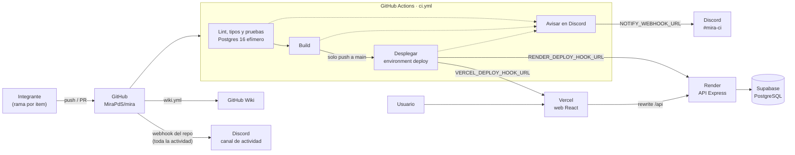

# Entrega 2

**Integración y despliegue continuo, y dos requerimientos funcionales nuevos.**
Tag previsto: `v2.0-entrega2` · CI/CD: **GitHub Actions** · Notificaciones:
**Discord** ([D14](https://github.com/MiraPdS/mira/blob/develop/docs/decisiones-tecnicas.md#d14--github-actions-como-cicd-oficial)).

## Objetivo de la entrega

Automatizar el ciclo de vida del software de Mira: que cada cambio se
verifique, se reporte y se despliegue solo, sin pasos manuales, y avise al
equipo cuando algo cambia. Sobre ese pipeline se construyen dos requerimientos
funcionales nuevos, **Sprints** y **columnas configurables del tablero**, que
pasan por el mismo CI desde su primer PR.

El enunciado pide Jenkins y Slack. Con autorización del profesor el equipo usa
GitHub Actions y Discord: el pipeline ya existía desde la Entrega 1 como check
obligatorio de `main`, y Jenkins obligaría a mantener una máquina encendida con
HTTPS y credenciales. El razonamiento completo y lo descartado están en
[D14](https://github.com/MiraPdS/mira/blob/develop/docs/decisiones-tecnicas.md#d14--github-actions-como-cicd-oficial).

## Qué se implementó

**18 items · 65 story points**, en tres frentes. Reparto, dependencias y ruta
crítica en
[`plan-trabajo-entrega2.md`](https://github.com/MiraPdS/mira/blob/develop/docs/plan-trabajo-entrega2.md);
criterios de aceptación en el
[backlog](https://github.com/MiraPdS/mira/blob/develop/docs/backlog.md#entrega-2).

### Sprints (épica MIR-41)

| Item | Qué hace | PR |
| --- | --- | --- |
| MIR-43 | Modelo y API de sprints: crear, listar, editar y eliminar, con permisos por rol | [#39](https://github.com/MiraPdS/mira/pull/39) |
| MIR-44 | Pantalla de sprints del proyecto: lista ordenada (activo, planificados, cerrados), crear y editar | [#42](https://github.com/MiraPdS/mira/pull/42) |
| MIR-45 | Asignar y quitar elementos de un sprint; filtro por sprint en el backlog; queda en el historial | [#47](https://github.com/MiraPdS/mira/pull/47) |
| MIR-46 | Iniciar y cerrar un sprint: un solo sprint activo, puntos comprometidos y completados, destino de lo no terminado | [#48](https://github.com/MiraPdS/mira/pull/48) |
| MIR-47 | Tablero del sprint activo, con su nombre y fechas, y la opción de ver todos los elementos | [#50](https://github.com/MiraPdS/mira/pull/50) |

### Columnas configurables del tablero (épica MIR-42)

| Item | Qué hace | PR |
| --- | --- | --- |
| MIR-31 | Los cuatro estados fijos pasan a columnas por proyecto, con categoría (por hacer, en curso, hecho). Migración que no pierde elementos | [#40](https://github.com/MiraPdS/mira/pull/40) |
| MIR-48 | API de columnas: crear, renombrar, reordenar y eliminar moviendo sus elementos a otra columna | [#44](https://github.com/MiraPdS/mira/pull/44) |
| MIR-49 | Tablero y backlog dibujan las columnas del proyecto; el historial traduce los estados antiguos | [#41](https://github.com/MiraPdS/mira/pull/41) |
| MIR-50 | Pantalla de configuración de columnas (solo OWNER), con confirmación y destino al eliminar | [#46](https://github.com/MiraPdS/mira/pull/46) |

Esto levanta el supuesto **S-02** de la Entrega 1 (columnas fijas) y cumple el
S-01 (sprints diferidos), ver
[Supuestos y dependencias](Proyecto-Supuestos-y-dependencias.md).

### CI/CD con GitHub Actions (épica MIR-40)

| Item | Qué hace | PR |
| --- | --- | --- |
| MIR-33 | Actions como CI/CD oficial: environment `deploy` atado a `main`, `enforce_admins`, secretos y cómo recrearlos | [#45](https://github.com/MiraPdS/mira/pull/45), [#49](https://github.com/MiraPdS/mira/pull/49) |
| MIR-51 | Resultado de cada prueba en formato JUnit, publicado como artefacto aunque las pruebas fallen | [#51](https://github.com/MiraPdS/mira/pull/51) |
| MIR-52 | Webhook de GitHub y estado en el commit: Actions ya publica el estado de cada check en el commit y el PR, se cerró sin trabajo | — |
| MIR-53 | Avisos en `#mira-ci`: pipeline en rojo, recuperación y resultado del despliegue | [#53](https://github.com/MiraPdS/mira/pull/53) |
| MIR-54 | Despliegue a Render y Vercel desde Actions, solo con el CI en verde | [#52](https://github.com/MiraPdS/mira/pull/52) |
| MIR-55 | Umbral de cobertura que pone rojo el pipeline | [#43](https://github.com/MiraPdS/mira/pull/43) |

Cierre de la entrega: esta página (MIR-56), el release `v2.0-entrega2`
(MIR-57) y la cápsula de video (MIR-58).

## Arquitectura e infraestructura

La aplicación no cambia de arquitectura respecto a la Entrega 1 (ver
[Arquitectura y tecnologías](Proyecto-Arquitectura-y-tecnologias.md)): web en
React servida por Vercel, API Express en Render y PostgreSQL en Supabase, con la
API bajo el mismo origen mediante un rewrite de Vercel
([D13](https://github.com/MiraPdS/mira/blob/develop/docs/decisiones-tecnicas.md#d13--mismo-origen-mediante-rewrite-de-vercel)).
Lo nuevo es quién despliega y quién avisa:



| Pieza | Rol | Configuración |
| --- | --- | --- |
| GitHub | Código, PRs, protección de `main`, Wiki | 1 aprobación, checks obligatorios, `enforce_admins` |
| GitHub Actions | Verifica, construye, despliega y avisa | [`ci.yml`](https://github.com/MiraPdS/mira/blob/develop/.github/workflows/ci.yml), [`wiki.yml`](https://github.com/MiraPdS/mira/blob/develop/.github/workflows/wiki.yml) |
| Discord | `#mira-ci` para el resultado del pipeline; otro canal para la actividad del repo | Dos webhooks separados, revocables por separado |
| Render | API y migraciones | Deploy hook; auto-deploy apagado desde el primer release |
| Vercel | Frontend y rewrite a la API | Deploy hook de `main`; `git.deploymentEnabled.main = false` |
| Supabase | PostgreSQL gestionado | Session pooler (la conexión directa es solo IPv6) |

Secretos, environment `deploy` y cómo recrear todo desde cero:
[`docs/ci-cd.md`](https://github.com/MiraPdS/mira/blob/develop/docs/ci-cd.md#cómo-recrear-la-configuración).
Ningún valor de secreto está en el repositorio.

## Pipeline

Un solo workflow, [`ci.yml`](https://github.com/MiraPdS/mira/blob/develop/.github/workflows/ci.yml),
en cada push y PR a `develop` y `main`:

| Job | Qué hace | Cuándo corre | Bloquea |
| --- | --- | --- | --- |
| `Lint, tipos y pruebas` | Formato, lint, tipos, migraciones y las tres suites con cobertura contra un Postgres 16 efímero. Publica los artefactos `cobertura` y `reporte-junit`, también si las pruebas fallan | Siempre | Sí, check obligatorio de `main` |
| `Build` | Compila web y API | Si el anterior pasó | Sí, check obligatorio de `main` |
| `Desplegar` | Confirma que el commit sigue siendo la punta de `main`, dispara Render con ese commit, luego Vercel, y espera a que `/api/health` conteste 200 | Solo en push a `main`, con los dos anteriores en verde | No: corre después de fusionar |
| `Avisar en Discord` | Publica en `#mira-ci` el fallo, la recuperación o el resultado del despliegue | Siempre, al final | No: un aviso fallido solo deja una advertencia |

- **Una ejecución roja no despliega**, y en un PR o en `develop` el despliegue
  queda _Skipped_: GitFlow, `main` es lo liberado y no hay staging.
- **El umbral de cobertura es parte del primer job** (MIR-55): si baja, el job
  queda rojo y el PR no se puede fusionar a `main`.
- **En `main` los runs van en serie y no se cancelan**, para no cortar un
  despliegue ya disparado. En PR y `develop` un push nuevo cancela el anterior.
- **Qué no garantiza un `Desplegar` verde:** que los servicios hayan terminado
  de desplegar la versión nueva; `/api/health` no informa el commit. Detalle en
  [Qué verifica el job](https://github.com/MiraPdS/mira/blob/develop/docs/ci-cd.md#qué-verifica-el-job).

## Integraciones

| Integración | Qué hace | Cómo se probó |
| --- | --- | --- |
| GitHub → Actions | Cada push y PR dispara `ci.yml`; el estado de cada job queda en el commit y en el PR (lo que pedía MIR-52) | Historial de [ejecuciones de `ci.yml`](https://github.com/MiraPdS/mira/actions/workflows/ci.yml) |
| Actions → Discord `#mira-ci` | 🔴 pipeline en rojo, 🟢 volvió a pasar, 🚀 despliegue terminado, 🔴 despliegue fallido, ⚠️ despliegue cancelado; cada aviso con rama, commit, autor y enlace | Fallo forzado ([run 41380199238](https://github.com/MiraPdS/mira/actions/runs/41380199238)) y su recuperación ([run 41380480549](https://github.com/MiraPdS/mira/actions/runs/41380480549)) con el webhook real |
| Actions → Render y Vercel | Deploy hooks desde el job `Desplegar`, solo en `main` | ⏳ Se comprueba en el primer release (MIR-57) |
| GitHub → Discord (actividad) | Webhook del repositorio: pushes, PR y comentarios, en un canal aparte | Configurado en Settings → Webhooks |
| Actions → GitHub Wiki | `wiki.yml` verifica `docs/wiki/` en cada PR y la publica al fusionar a `develop` | `Verificar Wiki` en cada PR |

`#mira-ci` solo habla cuando algo cambia: un verde después de otro verde no
avisa, y un run cancelado por un push más nuevo tampoco. Las reglas completas
están en
[Cuándo avisa `#mira-ci`](https://github.com/MiraPdS/mira/blob/develop/docs/ci-cd.md#cuándo-avisa-mira-ci).

## Cómo ejecutar el sistema

- **Demo desplegada:** [mira-pds.vercel.app](https://mira-pds.vercel.app),
  usuario `ada@mira.dev` / `demo1234` (datos de prueba, credenciales públicas a
  propósito). La primera petición puede tardar hasta un minuto si la API estaba
  dormida.
- **Local:** igual que en la Entrega 1, pasos en el
  [README](https://github.com/MiraPdS/mira#puesta-en-marcha):

```bash
cp .env.example .env    # completar JWT_SECRET
npm install
npm run db:up
npm run db:migrate -w @mira/api   # incluye sprints y columnas por proyecto
npm run db:seed
npm run dev             # API en :3000 · Web en :5173
```

- **Funcionalidades nuevas en la demo:** en un proyecto, _Ver sprints →_ desde
  el resumen; el tablero muestra el sprint activo y permite ver todos los
  elementos; las columnas se configuran en _Configuración_ (solo OWNER).
- **El pipeline:** no se ejecuta a mano. Corre solo en cada push o PR; para
  verlo, la pestaña
  [Actions](https://github.com/MiraPdS/mira/actions/workflows/ci.yml).

## Mejoras respecto a la Entrega 1

| Entrega 1 | Entrega 2 |
| --- | --- |
| CI en cada PR, sin umbral de cobertura | El pipeline queda rojo si la cobertura baja del umbral (MIR-55) |
| Resultados de pruebas solo en el log | Reporte JUnit y cobertura como artefactos de cada ejecución (MIR-51) |
| Render y Vercel desplegaban cada push a `main`, aunque el CI estuviera rojo | Solo despliega el job `Desplegar`, con el CI en verde y el commit que lo pasó (MIR-54) |
| Un build roto se veía solo entrando a GitHub | Aviso en `#mira-ci` al fallar, al recuperarse y al desplegar (MIR-53) |
| Administradores podían saltarse la protección de `main` | `enforce_admins`: nadie empuja directo a `main` (MIR-33) |
| Estados del tablero fijos (D8) | Columnas por proyecto, configurables por el OWNER |
| Sin sprints | Planificar, iniciar y cerrar sprints, con tablero del sprint activo |
| Uso de IA declarado en algunos PRs | Sección "Uso de IA" obligatoria en la plantilla de PR |

**Mejoras que quedan pendientes:**

- Exponer el commit en `/api/health` y esperar a que coincida, para que un
  `Desplegar` verde pruebe la versión nueva.
- Actualizar las acciones a versiones con Node 24: GitHub ya advierte que
  `actions/checkout@v4` y `actions/setup-node@v4` corren con Node 20.
- Pruebas E2E en la Entrega 3 (Selenium o Playwright, por decidir).

## Pruebas y su relación con CI

**Qué se probó:** las reglas nuevas en cada `service` (unitario), las rutas de
sprints y columnas contra PostgreSQL real, incluidas las migraciones con datos
y la concurrencia (integración), y las pantallas nuevas con la red simulada por
MSW (componente). Estrategia y umbrales en
[Estrategia de pruebas](Proyecto-Estrategia-de-pruebas.md).

**Relación con CI:** las tres suites corren en el job `Lint, tipos y pruebas`
de cada push y PR, con el umbral de cobertura activo. Un PR rojo no se puede
fusionar a `main`, y desde MIR-53 un rojo avisa en `#mira-ci`.

**Cómo ejecutarlas:**

```bash
npm test                  # todo, con un reporte de cobertura combinado
npm run test:unit         # sin Docker
npm run test:integration  # requiere npm run db:up
npm run test:coverage     # coverage/index.html
```

**Resultados en `develop`** al fusionar MIR-53
(commit [`4287759`](https://github.com/MiraPdS/mira/commit/42877596728dbbca908726b93e037c3d28de9eee),
[run 41511211159](https://github.com/MiraPdS/mira/actions/runs/41511211159)):

**1215 pruebas en 72 archivos, todas pasan; cobertura de líneas 97,24 %**
(ramas 90,48 %, funciones 97,06 %).

| Proyecto de Vitest | Nivel | Archivos | Pruebas | Entrega 1 |
| --- | --- | --- | --- | --- |
| `shared` | unitario | 10 | 224 | 107 |
| `api-unit` | unitario | 11 | 254 | 155 |
| `api-integration` | integración (PostgreSQL real) | 17 | 342 | 212 |
| `web` | componente (RTL + MSW) | 34 | 395 | 320 |
| **Total** | | **72** | **1215** | **794** |

Umbrales (MIR-55), fijados a partir de la línea base real:

| Alcance | Statements | Branches | Functions | Lines |
| --- | --- | --- | --- | --- |
| Global | 95 | 87 | 95 | 95 |
| Services de la API (`modules/**/*.service.ts`) | 98 | 95 | 98 | 98 |
| Hooks del frontend (`features/**/use*.ts`) | 98 | 85 | 98 | 98 |

Prueba de que el umbral rompe el build:
[run verde](https://github.com/MiraPdS/mira/actions/runs/40987420686) y
[run rojo por umbral](https://github.com/MiraPdS/mira/actions/runs/40994045311).

## Problemas encontrados y soluciones

- **Jenkins y Slack del enunciado.** Mantener Jenkins exigía una máquina
  encendida, con HTTPS y credenciales, o un PC del equipo expuesto con ngrok
  cuya URL cambia en cada arranque. Se pidió autorización y se usó GitHub
  Actions con Discord
  ([D14](https://github.com/MiraPdS/mira/blob/develop/docs/decisiones-tecnicas.md#d14--github-actions-como-cicd-oficial));
  los items MIR-33 y MIR-51 a MIR-55 se reescribieron para Actions
  ([#49](https://github.com/MiraPdS/mira/pull/49)).
- **Dos migraciones en paralelo sobre `work_items`.** MIR-31 (columnas) y
  MIR-43 (sprints) se desarrollaron a la vez y cambiaban la misma tabla. Al
  integrar, la migración de columnas se movió después de la de sprints, y la de
  MIR-49 pasó de `20261029120000` a `20261030130000`, sin cambiar el SQL. Un
  test de integración aplica la Entrega 1, luego MIR-43 con sprints y elementos
  asignados, y recién entonces MIR-31, y verifica que no se pierde nada
  ([#40](https://github.com/MiraPdS/mira/pull/40),
  [#41](https://github.com/MiraPdS/mira/pull/41)).
- **Asignar a un sprint mientras otro usuario lo cierra.** Sin coordinación, un
  elemento podía entrar a un sprint ya cerrado y quedar fuera de sus puntos, o
  podían quedar dos sprints activos. Se resolvió con transacciones Serializable
  y bloqueos compatibles: el cierre toma el sprint con `FOR UPDATE` y la
  asignación con `FOR SHARE`. Hay pruebas de concurrencia en ambos órdenes
  ([#47](https://github.com/MiraPdS/mira/pull/47),
  [#48](https://github.com/MiraPdS/mira/pull/48)).
- **El deploy hook de Vercel no acepta commit:** construye la punta de `main`.
  Si `main` avanzó durante un run, publicaría código sin CI. El job confirma
  primero que su commit sigue siendo la punta y, si no, queda rojo sin disparar
  nada ([#52](https://github.com/MiraPdS/mira/pull/52)).
- **Despliegue doble o ningún despliegue en el corte.** Si el auto-deploy de
  Render y Vercel se apagaba antes del job, `main` dejaba de desplegar; si se
  apagaba después, el primer release desplegaba dos veces. Vercel se corta con
  `git.deploymentEnabled` en el mismo commit que el job, y Render se apaga a
  mano justo antes de fusionar el release
  ([orden del corte](https://github.com/MiraPdS/mira/blob/develop/docs/ci-cd.md#corte-al-despliegue-desde-actions)).
- **El environment no se pudo llamar `production`:** los nombres no distinguen
  mayúsculas y `Production` ya lo usa la integración de Vercel; se habrían
  mezclado los historiales. Se llama `deploy`.
- **Un aviso que falla no debe poner rojo el pipeline.** Si no, un webhook roto
  marcaría rojo un código sano y la ejecución siguiente anunciaría una
  recuperación falsa. El envío fallido deja solo una advertencia, y la
  "ejecución anterior" se busca por rama, evento y repositorio
  ([#53](https://github.com/MiraPdS/mira/pull/53)).

**Defectos:** como en la Entrega 1, cada defecto encontrado en revisión se
corrigió dentro del PR de su item antes de fusionarlo, a pedido de la revisión
cruzada (por ejemplo en [#43](https://github.com/MiraPdS/mira/pull/43),
[#46](https://github.com/MiraPdS/mira/pull/46) y
[#47](https://github.com/MiraPdS/mira/pull/47)).

## Evidencia

La evidencia se entrega como enlaces revisables. Índice general en
[Evidencias](Proyecto-Evidencias.md).

- **Historial del pipeline:**
  [ejecuciones de `ci.yml`](https://github.com/MiraPdS/mira/actions/workflows/ci.yml);
  cada una con sus logs por paso y los artefactos `cobertura` y
  `reporte-junit`.
- **Pipeline completo en `develop`:**
  [run 41511211159](https://github.com/MiraPdS/mira/actions/runs/41511211159)
  (calidad, build y aviso en verde; `Desplegar` _Skipped_ porque no es `main`).
- **Umbral de cobertura:** [verde](https://github.com/MiraPdS/mira/actions/runs/40987420686)
  y [rojo por umbral](https://github.com/MiraPdS/mira/actions/runs/40994045311).
- **Avisos a Discord:** [fallo](https://github.com/MiraPdS/mira/actions/runs/41380199238)
  y [recuperación](https://github.com/MiraPdS/mira/actions/runs/41380480549),
  con `Aviso enviado a mira-ci` en el log del job.
- **Reporte JUnit como artefacto, también con pruebas fallidas:**
  [#51](https://github.com/MiraPdS/mira/pull/51).
- ⏳ **Despliegue desde Actions y aviso 🚀:** run del primer push a `main` con
  el release `v2.0-entrega2` (MIR-57).
- ⏳ **Release y tag:** `v2.0-entrega2` (MIR-57).
- **Tablero y criterios:**
  [Jira MIR](https://bolgunn.atlassian.net/jira/software/projects/MIR/boards) y
  el [backlog](https://github.com/MiraPdS/mira/blob/develop/docs/backlog.md#entrega-2).
- **Trazabilidad item → PR → pruebas:**
  [Requisitos y trazabilidad](Proyecto-Requisitos-y-trazabilidad.md): columnas
  en la épica 4, cierre en la 6, sprints en la 7 y CI/CD en su propia tabla.

## Uso de IA

Resumen de **lo declarado en los PRs** de la entrega. Desde esta entrega la
sección "Uso de IA" es obligatoria en la plantilla de PR.

| Herramienta declarada | PRs | Para qué |
| --- | --- | --- |
| Claude Code | [#38](https://github.com/MiraPdS/mira/pull/38), [#40](https://github.com/MiraPdS/mira/pull/40), [#44](https://github.com/MiraPdS/mira/pull/44), [#49](https://github.com/MiraPdS/mira/pull/49), [#51](https://github.com/MiraPdS/mira/pull/51), [#53](https://github.com/MiraPdS/mira/pull/53) | Plan y backlog, migración de columnas, API de columnas, workflow y documentación del CI/CD |
| Claude (Cowork) | [#42](https://github.com/MiraPdS/mira/pull/42), [#43](https://github.com/MiraPdS/mira/pull/43), [#46](https://github.com/MiraPdS/mira/pull/46), [#50](https://github.com/MiraPdS/mira/pull/50) | Pantallas de sprints y columnas, tablero del sprint activo, umbral de cobertura y sus pruebas |
| Codex / ChatGPT | [#39](https://github.com/MiraPdS/mira/pull/39), [#47](https://github.com/MiraPdS/mira/pull/47), [#48](https://github.com/MiraPdS/mira/pull/48) | Modelo, API y ciclo de vida de sprints, concurrencia y sus pruebas |
| Solo el pie "Generated with Claude Code" | [#41](https://github.com/MiraPdS/mira/pull/41), [#45](https://github.com/MiraPdS/mira/pull/45), [#52](https://github.com/MiraPdS/mira/pull/52) | La descripción no tiene la sección; no detalla qué parte del código |

En todos los casos el código pasó por revisión de otro integrante y por el CI
antes de entrar a `develop`.

## Supuestos y dependencias de esta entrega

Aplican los de
[Supuestos y dependencias](Proyecto-Supuestos-y-dependencias.md). Los que
cambian en esta entrega:

- **S-01:** se cumple; los sprints están implementados.
- **S-02:** se levanta; las columnas son configurables por proyecto.
- **S-10:** el ambiente desplegado sigue siendo una demo con datos de prueba.
- **D14:** el CI/CD es GitHub Actions con Discord, no Jenkins con Slack.

<!-- Generado desde docs/wiki/ en MiraPdS/mira. No editar aquí: se sobrescribe en el próximo sync. -->
