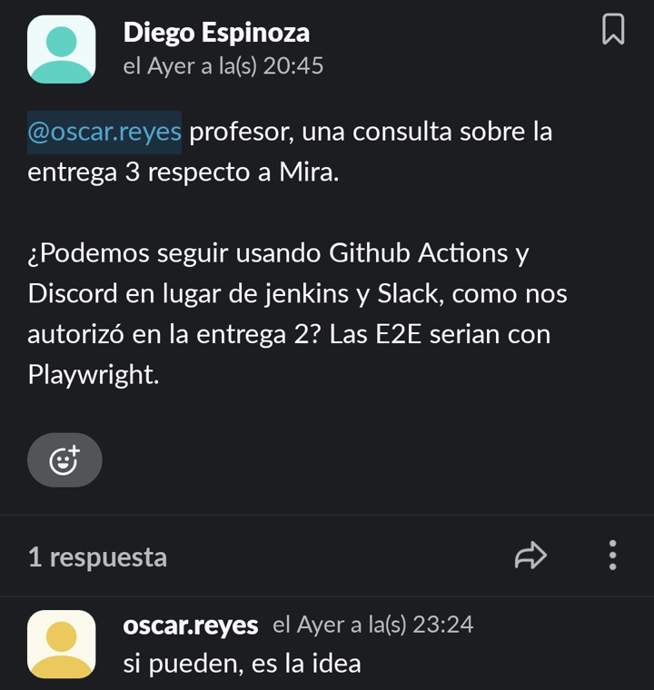
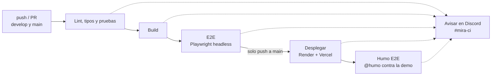
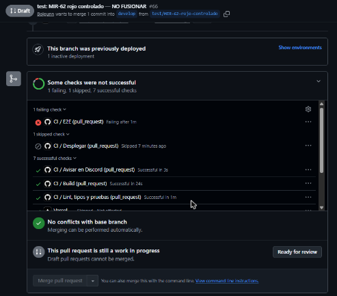
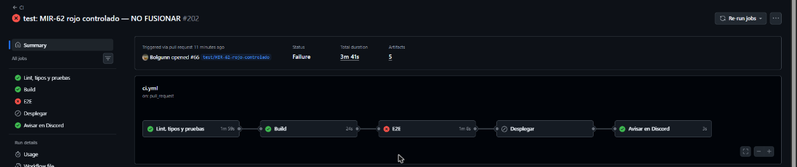
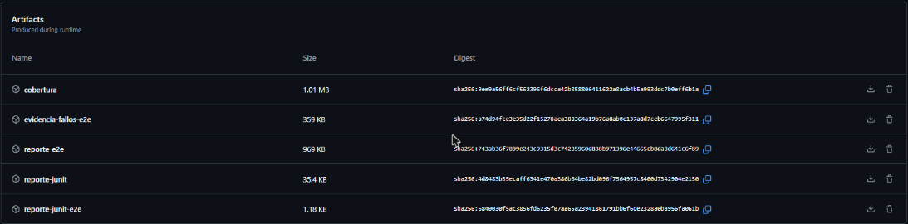
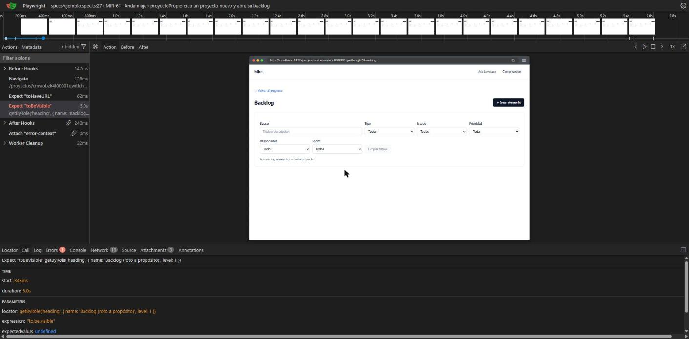
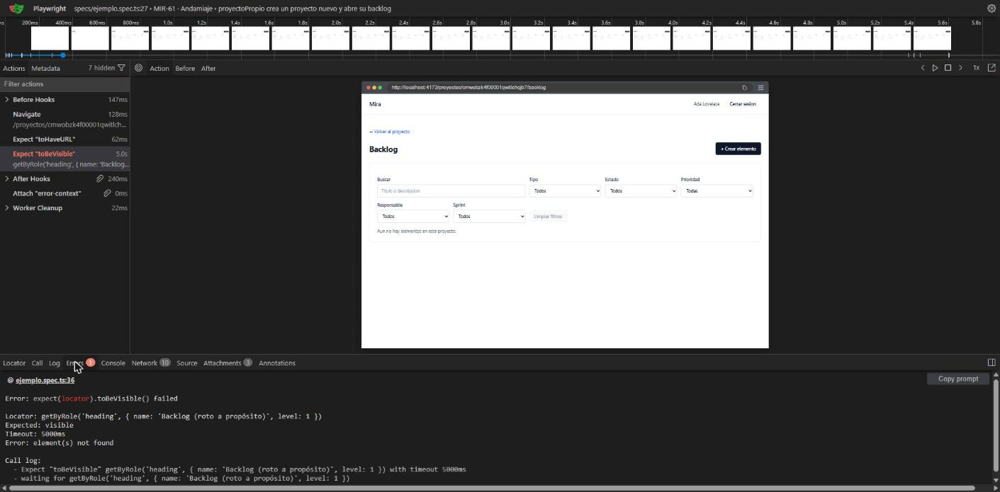
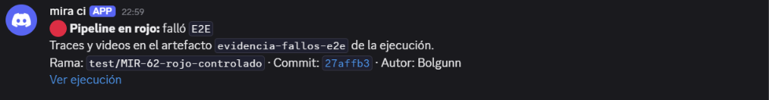
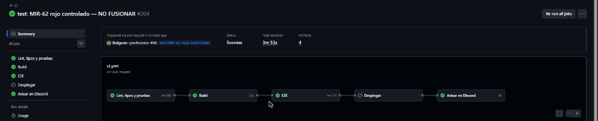
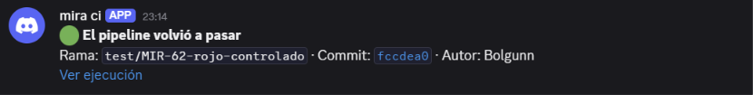

# Entrega 3

**Pruebas End-to-End automatizadas en el pipeline.**
Herramienta: **Playwright**
([D15](https://github.com/MiraPdS/mira/blob/develop/docs/decisiones-tecnicas.md#d15--playwright-como-herramienta-e2e)) ·
CI/CD: **GitHub Actions** con avisos en **Discord**
([D14](https://github.com/MiraPdS/mira/blob/develop/docs/decisiones-tecnicas.md#d14--github-actions-como-cicd-oficial)) ·
Tag previsto: `v3.0-entrega3` (MIR-76).

## 1. Objetivo

Verificar Mira como la usa una persona: en un navegador real, de punta a punta
(web → API → PostgreSQL), sin dobles. Las pruebas unitarias, de integración y
de componente de las entregas anteriores siguen igual; los E2E agregan el
cuarto nivel y prueban que las piezas funcionan juntas.

Los E2E son parte del pipeline, no una suite aparte:

- corren **headless en cada PR y push** a `develop` y `main`, en el job `E2E`;
- un E2E rojo **bloquea la fusión a `main`** (`E2E` es check obligatorio) e
  impide el despliegue. `develop` no tiene checks obligatorios: ahí el rojo
  queda visible en el PR y la regla del equipo es no fusionarlo;
- después de cada despliegue, un **humo de solo lectura** prueba la demo
  publicada;
- el resultado llega a `#mira-ci` en Discord, con traces, capturas y videos
  como artefactos.

**18 items · 48 story points** en la épica MIR-59. Reparto, DAG y ruta crítica
en [`plan-trabajo-entrega3.md`](https://github.com/MiraPdS/mira/blob/develop/docs/plan-trabajo-entrega3.md).

## 2. Herramienta y por qué

**Playwright 1.65.1** (`@playwright/test`, versión exacta), con Chromium en
modo headless. La decisión completa y lo descartado están en
[D15](https://github.com/MiraPdS/mira/blob/develop/docs/decisiones-tecnicas.md#d15--playwright-como-herramienta-e2e).
En resumen:

- **Mismo lenguaje que el resto del proyecto.** Las specs son TypeScript, con
  el mismo lint, formato y chequeo de tipos que la API y la web.
- **Esperas automáticas.** Cada `expect` reintenta hasta que la condición se
  cumple, así que no hacen falta `sleep`; esa es la causa más común de tests
  intermitentes con Selenium.
- **Selectores por rol y etiqueta** (`getByRole`, `getByLabel`), los mismos
  que ya usa React Testing Library en las pruebas de componente.
- **Evidencia incluida:** reporte HTML, JUnit, trace paso a paso, captura y
  video de cada fallo, sin plugins.
- **Móvil sin dispositivo:** un proyecto `mobile` (375×812, táctil) corre las
  specs etiquetadas `@movil`.
- **Sesiones por rol sin repetir el login:** `storageState` guarda una vez
  la sesión de ada (OWNER), alan (MEMBER) y grace (VIEWER).
- **Descartados:** Selenium WebDriver (un driver por navegador, runner aparte y
  sin esperas automáticas), Puppeteer (controla Chrome, pero no es un framework
  de pruebas: faltan runner, fixtures, reportes y trace) y Robot Framework
  (agrega Python y un lenguaje de palabras clave a un monorepo en TypeScript).
- **El enunciado lo permite:** Playwright es la primera alternativa a Selenium
  de la lista, y el equipo no lo había usado en Mira.

El enunciado pide Jenkins y Slack. El profesor confirmó el 18-11-2026 que el
equipo puede seguir con GitHub Actions y Discord en esta entrega:



## 3. Set de pruebas

**38 pruebas en el pipeline:** 35 E2E en 10 archivos (32 en `chromium` de
escritorio y 3 en `mobile`) más los 3 inicios de sesión del proyecto `setup`.
Todas pasan en el [run 44676923221](https://github.com/MiraPdS/mira/actions/runs/44676923221)
de `develop`: `38 passed (19.9s)` en el log, y 1 min 29 s el job
`E2E` completo, con la compilación y la instalación de Chromium.

| Spec | Item | Qué valida | Escenarios | Tests |
| --- | --- | --- | --- | --- |
| [`autenticacion.spec.ts`][autenticacion] | MIR-63 | Registro, inicio y cierre de sesión | Registro nuevo entra con sesión; correo repetido muestra error y no entra; contraseña incorrecta da el mensaje genérico; la sesión sobrevive a recargar; cerrar sesión vuelve a pedir login | 5 |
| [`proyectos-permisos.spec.ts`][proyectos] | MIR-65 | Crear proyectos y lo que ve cada rol | Clave válida crea y aparece como Propietario; clave inválida (`1ABC`) y repetida (`MIR`) muestran su error y no crean nada; grace (VIEWER) es Observador y no ve "Crear elemento" en backlog ni tablero, ni edición de proyecto o columnas; contrapruebas con ada (OWNER) | 10 |
| [`elementos.spec.ts`][elementos] | MIR-64 | CRUD de elementos | Crear, consultar, editar y eliminar un elemento; crear sin título muestra la validación y no crea nada | 2 |
| [`backlog.spec.ts`][backlog] | MIR-66 | Búsqueda, filtros y comentarios | Buscar por texto; combinar estado, prioridad y responsable; buscar y filtrar a la vez y "Limpiar filtros"; un comentario aparece con autor y fecha sin recargar y persiste | 4 |
| [`tablero.spec.ts`][tablero] | MIR-67 | Tablero e historial | Mover una tarjeta con "Mover a…" (también en móvil) y que persista; el movimiento queda en el historial del elemento | 2 (+1 móvil) |
| [`sprints.spec.ts`][sprints] | MIR-68 | Ciclo de un sprint | Planificar, asignar un elemento, iniciar, ver el tablero del sprint y cerrarlo con trabajo pendiente | 1 |
| [`columnas.spec.ts`][columnas] | MIR-69 | Columnas configurables | Agregar y reordenar una columna se refleja en el tablero y persiste; sin nombre se rechaza; eliminar una columna con elementos pide destino y mueve las tarjetas | 3 |
| [`movil.spec.ts`][movil] | MIR-70 | Navegación a 375 px | Recorrer proyectos → resumen → backlog → tablero → sprints sin scroll horizontal ni errores de la API; el tablero se desplaza dentro de su región, de a una columna | 2 (solo móvil) |
| [`humo.spec.ts`][humo] | MIR-72 | Humo de la demo (`@humo`) | Iniciar sesión con la cuenta de demo; abrir el tablero de `MIR` y ver sus columnas | 2 |
| [`ejemplo.spec.ts`][ejemplo] | MIR-61 | Que el andamiaje funcione | Pantalla de login; sesión guardada de ada; el fixture `proyectoPropio` | 3 |

Sin contar `ejemplo.spec.ts` (andamiaje) ni el humo (repite contra la demo
flujos que ya se prueban en local), las 9 specs de usuario cubren **13
flujos**, por encima de los 10 comprometidos:

| # | Flujo | Spec |
| --- | --- | --- |
| 1 | Registrarse | `autenticacion` |
| 2 | Iniciar sesión, mantenerla al recargar y cerrarla | `autenticacion` |
| 3 | Crear un proyecto y verlo en la lista | `proyectos-permisos` |
| 4 | Permisos por rol: VIEWER contra OWNER | `proyectos-permisos` |
| 5 | Crear, consultar, editar y eliminar un elemento | `elementos` |
| 6 | Buscar y filtrar el backlog | `backlog` |
| 7 | Comentar un elemento | `backlog` |
| 8 | Mover una tarjeta en el tablero | `tablero` |
| 9 | Ver el movimiento en el historial | `tablero` |
| 10 | Planificar, iniciar y cerrar un sprint | `sprints` |
| 11 | Agregar y reordenar columnas | `columnas` |
| 12 | Eliminar una columna con elementos | `columnas` |
| 13 | Navegar la aplicación en móvil | `movil` |

La trazabilidad de cada historia a su spec está en
[Requisitos y trazabilidad](Proyecto-Requisitos-y-trazabilidad.md#pruebas-e2e-entrega-3).

**Reglas comunes** ([`e2e/README.md`](https://github.com/MiraPdS/mira/blob/develop/e2e/README.md#convenciones)):

- Cada test es independiente y corren en paralelo (`fullyParallel`).
- El proyecto `MIR` del seed es de solo lectura. Lo que crea o modifica datos
  usa el fixture `proyectoPropio`, que crea un proyecto nuevo por API.
- Selectores por rol y etiqueta; `data-testid` solo donde no hay nombre
  accesible (tablero, MIR-67). Nada de CSS ni XPath.
- Sin `waitForTimeout` y con `retries: 0`: un test intermitente es un Bug en
  MIR-74, no un reintento.
- Cada "no ve X" tiene su contraprueba con un rol que sí lo ve, para que un
  selector roto no pase como "no está".
- Una spec nueva pasa tres veces seguidas en local antes de pedir revisión.

**El arrastre de tarjetas no se prueba en E2E:** "Mover a…" usa la misma
mutación y el mismo endpoint, y el arrastre ya tiene pruebas de componente.
Detalle en
[Estrategia de pruebas](Proyecto-Estrategia-de-pruebas.md#por-qué-los-e2e-no-arrastran-tarjetas).

## 4. Cómo ejecutar en local

Requisitos: Node 20.11 o superior, Docker, y libres los puertos 4173 (web) y
3100 (API de E2E); `db:up` usa además el 5443. Si algo ya escucha en el 3100,
Playwright lo reutiliza como API y los errores confunden.

```bash
npm install
npm run db:up                                   # Postgres de pruebas en 5443
npx -w @mira/e2e playwright install chromium    # solo la primera vez
npm run test:e2e                                # todo (chromium + mobile)
npm run test:e2e -- specs/autenticacion.spec.ts # un archivo
npm run test:e2e -- --project=mobile            # solo móvil
npm run test:e2e:ui                             # modo interactivo
npm run report -w @mira/e2e                     # último reporte HTML
```

`npm run test:e2e` hace todo solo:

1. Levanta la **API en :3100** contra la base `mira_e2e` y la **web en :4173**
   (`vite build` + `vite preview`, que reenvía `/api` a la API: un solo origen,
   como en Vercel).
2. `global-setup.ts` hace `prisma migrate reset` sobre `mira_e2e` (migra y
   siembra ada, alan, grace y el proyecto `MIR`). Solo acepta bases `*_e2e`.
3. El proyecto `setup` inicia sesión con los tres usuarios y guarda sus cookies.
4. Corren `chromium` (1280×800) y `mobile` (375×812).

**Contra otro ambiente:** con `BASE_URL` no se levantan servidores ni se
resetea la base. Si el host no es local (la demo), solo corren los `@humo`:

```bash
BASE_URL=https://mira-pds.vercel.app npm run test:e2e
```

Reportes en `e2e/playwright-report/` (HTML), `e2e/reportes/junit-e2e.xml` y,
de los tests que fallan, trace, captura y video en `e2e/test-results/`.
Para abrir un trace: `npx -w @mira/e2e playwright show-trace <ruta>/trace.zip`.

## 5. Integración con CI/CD



| | Job `E2E` (MIR-62) | Job `Humo E2E` (MIR-72) |
| --- | --- | --- |
| **Disparador** | Cada push y PR a `develop` y `main`, si `Build` pasó | Cada push a `main`, si `Desplegar` pasó |
| **Contra qué** | Stack efímero en el runner: Postgres 16 (`mira_e2e`), `node dist/server.js` en :3100 y `vite preview` en :4173 | La demo publicada, `BASE_URL=https://mira-pds.vercel.app` |
| **`BASE_URL`** | Sin definir: vale `http://localhost:4173` y Playwright levanta los servidores | Definida y remota: no levanta servidores ni toca bases; solo `@humo`, `expect` de 15 s y 1 worker |
| **Antes de probar** | Compila web y API sin `VITE_API_URL` e instala solo Chromium headless | Espera hasta 10 min a que el `<meta name="mira-commit">` de la demo sea el commit del run |
| **Tope** | 10 min el paso, 20 el job | 5 min el paso |
| **Si falla** | Job rojo; un PR a `main` no se puede fusionar (en `develop` no hay checks obligatorios: el rojo queda visible y la regla es no fusionar); `Desplegar` no corre; aviso 🔴 "falló `E2E`" | Run de `main` rojo y aviso 🔴 "Humo E2E falló contra la demo" (ya desplegado: se corrige con fix o rollback) |
| **Artefactos** | `reporte-e2e` y `reporte-junit-e2e` siempre; `evidencia-fallos-e2e` (traces, capturas, videos) si falla | `reporte-humo` siempre; `evidencia-fallos-humo` si falla |
| **¿Obligatorio?** | Sí, check obligatorio de `main` junto a `Lint, tipos y pruebas` y `Build` | No: nunca corre en un PR |

Todos los artefactos se guardan 90 días. Configuración completa en
[`ci.yml`](https://github.com/MiraPdS/mira/blob/develop/.github/workflows/ci.yml)
y [`docs/ci-cd.md`](https://github.com/MiraPdS/mira/blob/develop/docs/ci-cd.md#pruebas-e2e).

**Otros cambios del pipeline en esta entrega:**

- **MIR-71:** `/api/health` informa el `commit` desplegado y `Desplegar`
  espera a que coincida con el del release
  ([#71](https://github.com/MiraPdS/mira/pull/71)). Era un pendiente de la
  Entrega 2.
- **MIR-73:** `actions/checkout`, `setup-node` y `upload-artifact` suben a
  versiones con Node 24 ([#76](https://github.com/MiraPdS/mira/pull/76)).
  También era un pendiente de la Entrega 2.

## 6. Evidencias

### El rojo controlado (MIR-62)

Para probar que un E2E roto bloquea el pipeline se abrió el
[PR #66](https://github.com/MiraPdS/mira/pull/66) con **un solo cambio**: la
aserción de `ejemplo.spec.ts` espera un texto que no existe. Se cerró sin
fusionar; nada roto pasó por `develop`.

**El check `E2E` queda rojo en el PR** y `Desplegar` no corre
([run 44657161160](https://github.com/MiraPdS/mira/actions/runs/44657161160),
commit `27affb3`):





**Los artefactos del run rojo** incluyen `evidencia-fallos-e2e`:



**El trace** muestra el paso exacto que falló, con la página tal como estaba
(dice "Backlog", no el texto roto) y el error:





**El aviso 🔴 en `#mira-ci`:**



**La recuperación:** un segundo push restaura la aserción, `E2E` vuelve a
verde ([run 44658912087](https://github.com/MiraPdS/mira/actions/runs/44658912087),
commit `fccdea0`) y llega el aviso 🟢:





### Enlaces

- **Suite completa en verde en `develop`:**
  [run 44676923221](https://github.com/MiraPdS/mira/actions/runs/44676923221)
  (merge del #72, commit `9a16fcf`): `Lint, tipos y pruebas`, `Build`, `E2E`
  y el aviso en success; `Desplegar` y `Humo E2E` _Skipped_ porque no es
  `main`. Artefactos `reporte-e2e` (HTML) y `reporte-junit-e2e`. En el log del
  paso `Pruebas E2E`: `38 passed`.
- **Rojo controlado:** [PR #66](https://github.com/MiraPdS/mira/pull/66),
  [run rojo](https://github.com/MiraPdS/mira/actions/runs/44657161160) y
  [run verde](https://github.com/MiraPdS/mira/actions/runs/44658912087).
- **Primer job `E2E`:** [PR #64](https://github.com/MiraPdS/mira/pull/64).
- **Humo contra la demo:** se ejecuta con el push del release a `main`
  (MIR-76); su run se enlaza en el cierre del release.
- **Historial del pipeline:**
  [ejecuciones de `ci.yml`](https://github.com/MiraPdS/mira/actions/workflows/ci.yml).
- **PRs de la entrega:**
  [#61](https://github.com/MiraPdS/mira/pull/61) andamiaje ·
  [#62](https://github.com/MiraPdS/mira/pull/62) D14 y D15 ·
  [#63](https://github.com/MiraPdS/mira/pull/63) auth ·
  [#64](https://github.com/MiraPdS/mira/pull/64) job E2E ·
  [#65](https://github.com/MiraPdS/mira/pull/65) proyectos y permisos ·
  [#67](https://github.com/MiraPdS/mira/pull/67) elementos ·
  [#68](https://github.com/MiraPdS/mira/pull/68) móvil ·
  [#69](https://github.com/MiraPdS/mira/pull/69) evidencia del rojo ·
  [#70](https://github.com/MiraPdS/mira/pull/70) sprints ·
  [#71](https://github.com/MiraPdS/mira/pull/71) commit en health ·
  [#72](https://github.com/MiraPdS/mira/pull/72) humo ·
  [#73](https://github.com/MiraPdS/mira/pull/73) tablero ·
  [#74](https://github.com/MiraPdS/mira/pull/74) filtros y comentarios ·
  [#75](https://github.com/MiraPdS/mira/pull/75) columnas ·
  [#76](https://github.com/MiraPdS/mira/pull/76) Node 24.
- **Índice general:** [Evidencias](Proyecto-Evidencias.md#entrega-3).

## 7. Problemas encontrados y soluciones

Anotados mientras ocurrían, desde la primera ola.

**Del andamiaje y el entorno**

- **El servidor de la API nunca "arrancaba".** Playwright espera a sus
  `webServer` antes del `globalSetup`, y el `/api/health` fallaba porque
  `mira_e2e` todavía no existía. Ahora se espera el puerto, no el health
  ([MIR-61](https://github.com/MiraPdS/mira/pull/61)).
- **Prisma bloquea `migrate reset` cuando lo corre un agente de IA.** Desde
  Prisma 6 el CLI pide un consentimiento explícito
  (`PRISMA_USER_CONSENT_FOR_DANGEROUS_AI_ACTION`). A las personas y a Actions
  no les afecta; al trabajar con un agente se autoriza solo el reset de
  `mira_e2e`.
- **Cliente de Prisma desactualizado.** Después de un `git pull` con
  migraciones nuevas, `typecheck` fallaba (`boardColumn`, `Sprint`) hasta
  correr `npm run db:generate -w @mira/api`.
- **Advertencia `EPERM` en Windows.** Al resetear la base, Prisma intenta
  reemplazar su DLL mientras la API de E2E la tiene abierta y avisa `EPERM`.
  Es inofensiva: los tests corren igual. Quedó anotada para no perder tiempo
  con ella.
- **La web del build normal no sirve para E2E.** El job `Build` compila con
  `VITE_API_URL=http://localhost:3000/api`, que se salta el proxy de
  `vite preview`. El job `E2E` compila de nuevo sin esa variable
  ([MIR-62](https://github.com/MiraPdS/mira/pull/64)).

**De las specs**

- **Encabezados que no existían.** Las primeras versiones buscaban el nombre
  del proyecto como encabezado, pero el backlog no lo muestra y el resumen se
  titula "Resumen del proyecto". Ahora las specs afirman lo que la pantalla
  realmente muestra (MIR-61, MIR-65).
- **Chequeos negativos que pasaban demasiado pronto.** "grace no ve Crear
  elemento" podía pasar antes de que la página cargara el rol, y daba verde
  aunque el botón apareciera después. La revisión cruzada lo detectó. Ahora
  se espera a que desaparezca "Cargando proyecto...", el tablero se abre
  navegando desde el backlog para que el rol ya esté en caché, y cada "no ve"
  tiene su contraprueba con ada ([#65](https://github.com/MiraPdS/mira/pull/65)).
- **Un clic que podía caer en la página anterior (móvil).** Al pasar de "Mis
  proyectos" al resumen, el enlace "Ver tablero" podía encontrar los enlaces
  "Ver tablero de …" de las tarjetas de `/proyectos` antes de que cambiara la
  ruta. La revisión del [#68](https://github.com/MiraPdS/mira/pull/68) llevó a
  esperar que cada vista cargue por completo ("Resumen del proyecto", sin
  "Cargando…" ni alertas) y a registrar las excepciones de la página y las
  respuestas `/api` con error, para que un fallo diga qué petición falló.
- **Arrastrar tarjetas no es determinista** en Playwright (sensores de
  dnd-kit, coordenadas, auto-scroll). Los E2E usan "Mover a…", que llama al
  mismo endpoint ([#73](https://github.com/MiraPdS/mira/pull/73)).

**Del pipeline**

- **Un timeout del job no avisaba.** Si el job supera su `timeout-minutes`
  queda `cancelled`, y de un cancelado el aviso no dice nada. El tope va en el
  paso: un paso que se pasa de tiempo queda `failure` y avisa "falló E2E"
  (revisión del [#64](https://github.com/MiraPdS/mira/pull/64)).
- **El humo podía probar el frontend anterior.** `Desplegar` puede terminar
  antes de que Vercel publique la web nueva. El job espera a que el meta
  `mira-commit` de la demo sea el commit del run
  ([#72](https://github.com/MiraPdS/mira/pull/72)).
- **Las credenciales de la demo son públicas:** cualquiera puede cambiar sus
  datos. El humo solo lee lo que el seed asegura en cada deploy y nunca crea
  datos: `proyectoPropio` falla a propósito con un `BASE_URL` definido.
- **Runs cancelados al fusionar seguido.** Al fusionar varios PRs en minutos,
  los runs de `develop` de #68 y #73 se cancelaron por un push más nuevo. El
  run siguiente ([44673669582](https://github.com/MiraPdS/mira/actions/runs/44673669582),
  merge del #74) corrió la suite completa con esos cambios, en verde.

**Defectos de la aplicación (MIR-74):** los E2E no destaparon defectos en
Mira; no se abrió ningún Bug. Los cambios al código de la app fueron de
soporte a las pruebas: `data-testid` estables en el tablero (MIR-67), el
commit en `/api/health` (MIR-71) y el meta `mira-commit` en la web (MIR-72).

## 8. Pendientes

- **Release `v3.0-entrega3` (MIR-76):** PR `develop → main`, tag y GitHub
  Release. Su push a `main` corre por primera vez `Desplegar` seguido de
  `Humo E2E` contra la demo.
- **Cápsula de video (MIR-77)**, grabada sobre el release.
- **Congelar la evidencia E2E:** `scripts/wiki-evidencias.mjs` hoy solo lee el
  artefacto `cobertura`. Los reportes E2E viven 90 días como artefactos; queda
  como mejora congelarlos en una página `Evidencias-Entrega-3`.
- **Conteo de tests fallidos en el aviso de Discord:** hoy dice qué job falló
  y dónde están los traces, no cuántos tests. Se dejó fuera porque igual hay
  que abrir la ejecución.
- **Caché de navegadores en CI:** no se usa porque Playwright la desaconseja;
  se agrega si el job se vuelve lento (hoy tarda alrededor de 1 min 30 s).

## Uso de IA

Igual que en la Entrega 2, cada PR declara en su sección "Uso de IA" qué
herramienta se usó y para qué (planificar, escribir specs y documentar).
Todos los PRs pasaron por la revisión de otro integrante. Cada spec pasó tres
corridas locales seguidas antes de pedir revisión, y desde el
[#64](https://github.com/MiraPdS/mira/pull/64) cada PR pasó además por el job
`E2E`. Los PRs anteriores (#61 y #63) se validaron solo en local, y los de
documentación no corren specs.

[autenticacion]: https://github.com/MiraPdS/mira/blob/develop/e2e/specs/autenticacion.spec.ts
[proyectos]: https://github.com/MiraPdS/mira/blob/develop/e2e/specs/proyectos-permisos.spec.ts
[elementos]: https://github.com/MiraPdS/mira/blob/develop/e2e/specs/elementos.spec.ts
[backlog]: https://github.com/MiraPdS/mira/blob/develop/e2e/specs/backlog.spec.ts
[tablero]: https://github.com/MiraPdS/mira/blob/develop/e2e/specs/tablero.spec.ts
[sprints]: https://github.com/MiraPdS/mira/blob/develop/e2e/specs/sprints.spec.ts
[columnas]: https://github.com/MiraPdS/mira/blob/develop/e2e/specs/columnas.spec.ts
[movil]: https://github.com/MiraPdS/mira/blob/develop/e2e/specs/movil.spec.ts
[humo]: https://github.com/MiraPdS/mira/blob/develop/e2e/specs/humo.spec.ts
[ejemplo]: https://github.com/MiraPdS/mira/blob/develop/e2e/specs/ejemplo.spec.ts

<!-- Generado desde docs/wiki/ en MiraPdS/mira. No editar aquí: se sobrescribe en el próximo sync. -->
